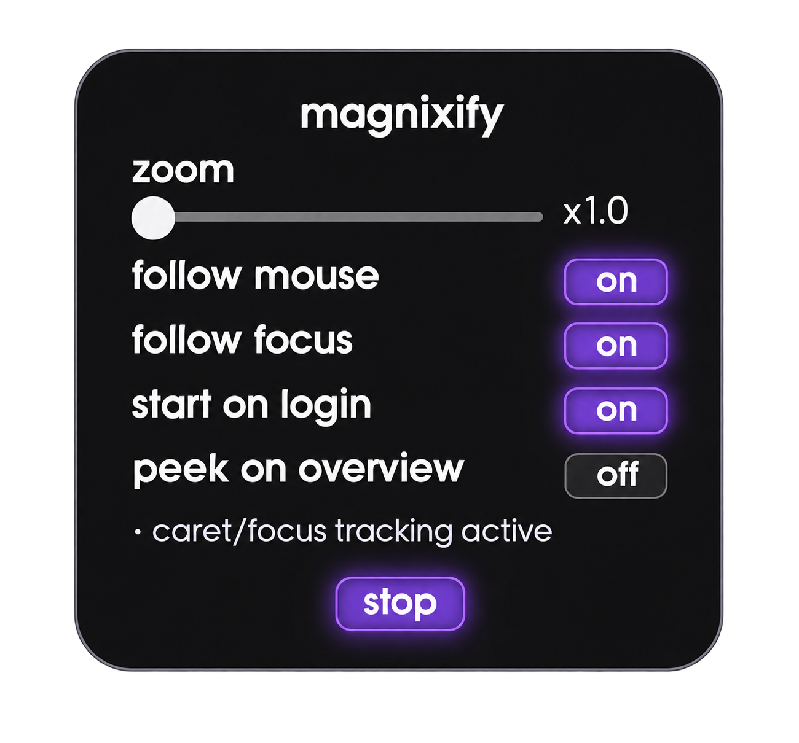

# **magnixify-gnome-shell-extension**

[ "")](https://github.com/sponsors/QuackHack-McBlindy) [](https://buymeacoffee.com/quackhackmcblindy)

<br>

## **Improved Accessibility Magnify Your Monitor**

This project aims to fill the gaps when it comes to accessibility on Linux systems for visually impaired people.<br>
At first glance it looks like the GNOME magnifier has everything a user would require.<br>
But users who has actually used it has found that it's just good enough to keep you from pulling your hair out.<br>
Instead of the magnifier following the content, it does the opposite and moves the magnifier AWAY from the text that users are typing.<br>

Disabling the built-in magnifier and enabling **magnixify** allows blind people to have a **much more** pleasent Linux desktop experience.<br>

**🧑‍🦯 By blind people - for blind people!** <br>

<br>

## **Features**

- **Smooth zoom** from `1.0x` to `8.0x` with animated transitions.
- **Follow mouse** – the magnifier tracks the pointer as it moves.
- **Follow focus** – tracks the text or caret via AT-SPI2.
- **Peek mode** – temporarily drops back to `1.0x` while `Super` or `Alt` is held, or while the overview is open.
- **Cursor scaling** – the mouse cursor grows with the zoom level.
- **D-Bus interface** – control zoom externally or with keybindings.
- **Preferences** – toggle follow modes, auto-start and other options from the top panel menu.




<br>

## **Installation**

**Manual installation:**

```bash
git clone https://github.com/QuackHack-McBlindy/magnixify-gnome-shell-extension.git
cd magnixify-gnome-shell-extension
bash install.sh
```

<br>


<details><summary><strong>
❄️ Installing Using Flakes (NixOS)
</strong></summary>


#### **Add magnixify as an input in your flake:**

```nix
  inputs = {
    nixpkgs.url   = "github:NixOS/nixpkgs/nixos-unstable";
    magnixify.url = "github:quackhack-mcblindy/magnixify-gnome-shell-extension";
  };
```

<br>
The flake provides the extension as a package.<br>

```nix
{
  environment.systemPackages = [ inputs.magnixify.packages.${pkgs.system}.default ];
}
```

To use magnixify declaratively:<br>


```nix
{
  services.gnome.at-spi2-core.enable = true;

  environment.systemPackages = [ pkgs.dconf ];
  programs.dconf.enable = true;

  programs.dconf.profiles.user.databases = [{
    settings = {
      "org/gnome/shell" = {
        enabled-extensions = [
          "magnixify@quackhack-mcblindy.com"    
        ];  
      };
    
      # KEYBINDINGS
      "org/gnome/settings-daemon/plugins/media-keys" = {
        custom-keybindings = [
          "/org/gnome/settings-daemon/plugins/media-keys/custom-keybindings/custom1/"
          "/org/gnome/settings-daemon/plugins/media-keys/custom-keybindings/custom2/"
          "/org/gnome/settings-daemon/plugins/media-keys/custom-keybindings/custom3/"
        ];
      };  
      "org/gnome/settings-daemon/plugins/media-keys/custom-keybindings/custom1" = {
        name = "Toggle Zoom";
        binding = "KP_Divide";
        command = ''
          gdbus call --session --dest "org.gnome.Shell.Extensions.Magnixify" \
            --object-path "/org/gnome/Shell/Extensions/Magnixify" --method "org.gnome.Shell.Extensions.Magnixify.Toggle"
        '';
      };
      "org/gnome/settings-daemon/plugins/media-keys/custom-keybindings/custom2" = {
        name = "Zoom in";
        binding = "KP_Add";
        command = ''
          gdbus call --session --dest "org.gnome.Shell.Extensions.Magnixify" \
            --object-path "/org/gnome/Shell/Extensions/Magnixify" --method "org.gnome.Shell.Extensions.Magnixify.ZoomIn"
        '';
      };
      "org/gnome/settings-daemon/plugins/media-keys/custom-keybindings/custom3" = {
        name = "Zoom out";
        binding = "KP_Subtract";
        command = ''
          gdbus call --session --dest "org.gnome.Shell.Extensions.Magnixify" \
            --object-path "/org/gnome/Shell/Extensions/Magnixify" --method "org.gnome.Shell.Extensions.Magnixify.ZoomOut"
        '';
      };
    };
  }];
}  
``` 

<br>

**Rebuild your system and finally restart your host.**

</details>
<br>

## **Key Bindings**

The extension exports the following interface while it is enabled:<br>

**Bus name:** `org.gnome.Shell.Extensions.Magnixify`<br>
**Object path:** `/org/gnome/Shell/Extensions/Magnixify`<br>
**Interface:** `org.gnome.Shell.Extensions.Magnixify`<br>

This allows the user to control the extension through `gdbus` and therefore bind keyboard shortcuts to control the magnifier.<br><br>

Open the GNOME **Settings:**<br>
**->** press **Keyboard** *(left side)* **->** press **View and Customize Shortcuts** **->** **Custom Shortcuts** **->** and click **+ Add Shortcut**.<br>

**Toggle Zoom (on/off)**

```bash
gdbus call --session --dest "org.gnome.Shell.Extensions.Magnixify" --object-path "/org/gnome/Shell/Extensions/Magnixify" --method "org.gnome.Shell.Extensions.Magnixify.Toggle"
```

<br>

**Zoom in**

```bash
gdbus call --session --dest "org.gnome.Shell.Extensions.Magnixify" --object-path "/org/gnome/Shell/Extensions/Magnixify" --method "org.gnome.Shell.Extensions.Magnixify.ZoomIn"
```

<br>

**Zoom out**

```bash
gdbus call --session --dest "org.gnome.Shell.Extensions.Magnixify" --object-path "/org/gnome/Shell/Extensions/Magnixify" --method "org.gnome.Shell.Extensions.Magnixify.ZoomOut"
```

<br>


## **Notes / Debugging**

Each application handles caret differently.<br>
Some of them may require special configuration for track focus to work.<br>
Here I will try to list some of them. Always check if it already works before making any changes.<br><br>

<details><summary><strong>
Firefox
</strong></summary>

Type `about:config` in the address bar and hit enter.<br>

```
"accessibility.browsewithcaret" = true;
"accessibility.force_disabled"  = -1;
```

</details>


<br>

## **License**

This project is licensed under the terms of the MIT license.<br>
See the `LICENSE` file in the repository for full details.<br>

Contributions are welcomed.

